<div align="center">

  

  # 📋 Awesome Service Catalog

  <p align="center">
    <strong>A curated directory of top-tier Enterprise Service Catalogs, Self-Service Request Portals, ITSM/ESM Platforms &amp; Fulfillment Automation Workflows.</strong>
  </p>

  <p align="center">
    <a href="https://github.com/ishandutta2007/Awesome-Awesome-Awesome"></a><a href="https://discord.gg/jc4xtF58Ve"></a>
    <a href="https://github.com/ishandutta2007/Awesome-Service-Catalog/stargazers"></a>
    <a href="https://github.com/ishandutta2007/Awesome-Service-Catalog/network/members"></a>
    <a href="https://github.com/ishandutta2007/Awesome-Service-Catalog/blob/main/LICENSE"></a>
    <a href="https://github.com/ishandutta2007/Awesome-Service-Catalog/pulls"></a>
    <a href="https://github.com/ishandutta2007"></a>
  </p>

</div>

---

## 📖 Overview &amp; Architecture Landscape

In modern digital enterprises, an **IT Service Catalog** (and broader **Enterprise Service Management / ESM Catalog**) functions as the unified customer-facing storefront for all organizational capabilities. It converts manual email chains, unmanaged instant messages, and informal shoulder-taps into structured, audit-ready service requests—spanning IT hardware procurement, cloud application provisioning, employee onboarding, security access approvals, and facilities maintenance.

A robust Service Catalog architecture integrates five mission-critical layers:
1. **Consumerized Self-Service Storefront**: Intuitive, taxonomy-driven menus and GenAI conversational assistants empowering employees to locate and request services effortlessly.
2. **Dynamic Form &amp; Validation Engine**: Multi-tiered conditional fields, asset lookups, and dependent dropdowns capturing complete fulfillment context upfront.
3. **Multi-Stage Approval Hierarchies**: Rule-based manager approvals, financial threshold reviews, and security sign-offs executed via email, mobile, or collaboration hubs (Slack/Teams).
4. **Fulfillment Orchestration &amp; Automation**: Zero-touch API connectors, webhook dispatchers, and BPMN/RPA pipelines automating user provisioning (Active Directory/Okta/SaaS), device allocation, and software deployments.
5. **SLA &amp; Lifecycle Governance**: Precise tracking of response/resolution Service Level Agreements, operational metrics, and transparent status updates.

Whether deploying enterprise SaaS ecosystems with cross-departmental reach or sovereign, self-hosted open-source stacks ensuring complete data governance without recurring per-agent licensing fees, selecting the appropriate Service Catalog architecture directly impacts operational efficiency and user satisfaction.

---

## 📑 Table of Contents

- [🌐 Sector Overview &amp; Market Dynamics](#-sector-overview--market-dynamics)
- [☁️ SaaS &amp; Hosted Service Catalog Platforms](#️-saas--hosted-service-catalog-platforms)
- [🔓 Open-Source GitHub Projects (Ranked by Stars)](#-open-source-github-projects-ranked-by-stars)
- [📊 Architectural Comparison Matrix](#-architectural-comparison-matrix)
- [🤝 How to Contribute](#-how-to-contribute)
- [📈 Star History](#-star-history)
- [💖 Support &amp; Sponsorship](#-support--sponsorship)
- [⚖️ Disclaimer](#️-disclaimer)

---

## 🌐 Sector Overview &amp; Market Dynamics

The global **IT Service Management (ITSM) and Enterprise Service Catalog market** was valued at approximately **$14.2 Billion in 2024** and is projected to expand to **$34.5 Billion by 2030**, exhibiting a robust Compound Annual Growth Rate (**CAGR of ~14.2%**). This sustained acceleration is driven by enterprise-wide digital transformation, consumerization of employee support, widespread adoption of generative AI ticket deflection, and the expansion of ITSM practices into HR, Legal, and Facilities under unified Enterprise Service Management (ESM) frameworks.

Market concentration follows a two-tier structure:
1. **Enterprise Tier (Highly Concentrated / Winner-Take-All)**: The high-end enterprise segment is heavily dominated by **ServiceNow**, which commands a near-monopoly among Global 2000 organizations as the central operational backbone, with **Atlassian Jira Service Management** capturing substantial market share among engineering-led and agile organizations.
2. **Mid-Market &amp; Sovereign Self-Hosted Tier (Moderately Fragmented)**: The mid-market, SME, and sovereign data segments exhibit healthy fragmentation and vigorous price competition. Challenger platforms such as **Freshservice**, **ManageEngine ServiceDesk Plus**, **SolarWinds Service Desk**, and **HaloITSM** provide competitive, transparent all-inclusive models. Concurrently, sovereign open-source platforms (such as **GLPI**, **Zammad**, **FreeScout**, and **iTop**) continue to thrive in regulated industries, government entities, and cost-conscious organizations seeking to eliminate escalating per-seat SaaS costs.

---

## ☁️ SaaS &amp; Hosted Service Catalog Platforms

The table below catalogs premier commercial SaaS solutions for enterprise Service Catalogs, sorted in descending order by **Company Scale (Valuation / Revenue)**.

| Platform / Service | Company Scale (Revenue / Valuation) 🔽 | Starting Tier Pricing | Free Tier Limits &amp; Trials | Core Service Catalog Capabilities |
| :--- | :--- | :--- | :--- | :--- |
| **[ServiceNow Service Catalog](https://www.servicenow.com/)** | **~$150B Market Cap**<br>($13.28B Annual Revenue) | **$70.00 / fulfiller / mo**<br>*(ITSM Foundation list tier)* | **Free Personal Developer Instance (PDI)** with full admin API access for non-production development (hibernates after 10 days of inactivity); 30-day enterprise evaluation PoC upon sales request | Enterprise Catalog Builder with low-code visual item creation, multi-department taxonomy (IT, HR, Facilities), variable cascading, and REST APIs for automated orchestration flows |
| **[Jira Service Management](https://www.atlassian.com/software/jira/service-management)** | **~$55B Market Cap**<br>($5.22B Annual Revenue) | **$17.50 / agent / mo**<br>*(Standard tier billed annually, or $21.50/mo billed monthly)* | **Free forever plan** for up to **3 agents**, 2 GB file storage, 100 automation rule runs/month, unlimited customer portal requestors, and community support | Customizable request types directly mapped to Jira issue workflows, native Confluence knowledge base deflection, automated approval hierarchies, and dynamic forms |
| **[BMC Helix Digital Workplace](https://www.bmc.com/)** | **~$18B Valuation**<br>($2.30B Annual Revenue, KKR) | **$115.00 / named user / mo**<br>*(BMC Helix ITSM Service Desk entry tier)* | **30-day structured evaluation trial** / role-tailored sandbox environment (no permanent free tier; credit card not required) | Consumer-grade omni-channel app store, AI-assisted Service Catalog Curator, pre-built departmental content packs (IT/HR/Workplace), and multi-cloud fulfillment connectors |
| **[ManageEngine ServiceDesk Plus](https://www.manageengine.com/products/service-desk/)** | **~$12.5B Valuation**<br>($1.50B+ Zoho Corp Revenue) | **$13.00 / technician / mo**<br>*(Standard Cloud plan billed annually, or $22/mo billed monthly)* | **Free forever plan** for up to **5 technicians**, unlimited self-service end-user requestors, incident tracking, and knowledge base; 30-day enterprise trial with zero gating | Drag-and-drop service catalog designer, multi-stage approval workflows, granular role-based item visibility, dynamic cost calculations, and pre-built request templates |
| **[Ivanti Neurons for ITSM](https://www.ivanti.com/)** | **~$4.5B Valuation**<br>($1.20B Annual Revenue, Clearlake) | **$95.00 / analyst / mo**<br>*(ITSM Professional base tier)* | **30-day sales-assisted Proof of Concept (PoC)** sandbox environment (no permanent free tier; demo required) | Responsive Page Designer for cross-device service menus, preset persona audience filters, save-for-later draft submissions, and zero-touch fulfillment integration |
| **[Freshservice](https://www.freshworks.com/freshservice/)** | **~$3.8B Market Cap**<br>($839M Annual Revenue) | **$19.00 / agent / mo**<br>*(Starter plan billed annually, or $29/mo billed monthly)* | **14-day fully featured free trial** supporting up to 10 agents with Pro/Enterprise capabilities; no credit card required (no permanent free tier) | 3-tier catalog hierarchy (categories, subcategories, items), nested item bundling, dynamic conditional fields, asset association, and multi-department fulfillment tickets |
| **[SolarWinds Service Desk](https://www.solarwinds.com/service-desk)** | **~$3.2B Market Cap**<br>($797M Annual Revenue) | **$39.00 / technician / mo**<br>*(Essentials plan billed annually)* | **30-day fully functional free trial** with Premier-tier feature access, unlimited requestors, and no credit card required (no permanent free tier) | GenAI-powered service request creation, customizable task groups, conditional approval trees, SLA timer pause conditions, and integrated hardware procurement tracking |
| **[Cherwell Service Management](https://www.cherwell.com/)** | **~$1.2B Parent Scale**<br>($300M+ Acquisition valuation) | **$65.00 / concurrent agent / mo**<br>*(Core Service Desk entry tier)* | **30-day guided evaluation sandbox** via certified partner network (no permanent free tier; requires sales alignment) | Modular Work Units and Service Catalog Templates model, codeless mApp extensions, customizable self-service web portal, and multi-step fulfillment chains |
| **[HaloITSM](https://www.haloitsm.com/)** | **~$250M Valuation**<br>($40M Annual Revenue) | **$49.00 / agent / mo**<br>*(All-inclusive tier, 50+ agents, or $79/mo for 10-19 agents)* | **30-day fully functional free trial** with zero feature gating, unlimited test requestors, and no credit card required (no permanent free tier) | All-inclusive non-tiered licensing, free unlimited end-user portals, dynamic Optional Services (child tickets for grouped hardware/software bundles), and per-service security overrides |
| **[SysAid](https://www.sysaid.com/)** | **~$100M Valuation**<br>($20M Annual Revenue, IGP) | **$89.00 / agent / mo**<br>*(Professional AI-native plan)* | **14-day fully functional free trial** with platform evaluation tools and workflow templates; no credit card required (no permanent free tier) | Category Pointers auto-navigation, SysAid Copilot GenAI conversational request submission, tree-structured folder menus, and embedded IT asset management |

---

## 🔓 Open-Source GitHub Projects (Ranked by Stars)

Sovereign, community-driven, and self-hosted open-source ITSM and request portal platforms. Entries are sorted in descending order by **GitHub Star Count**, with live social star badges linking directly to each project's stargazers community.

- **[GLPI](https://github.com/glpi-project/glpi)** [](https://github.com/glpi-project/glpi/stargazers)  
  *Comprehensive Open-Source ITSM &amp; Service Management Platform (GPL-3.0)*  
  Features an enterprise-grade service catalog module for defining complex requestable items, multi-criteria ticket forms, automated approval routings, and SLA timers. Natively integrates with a comprehensive CMDB, asset inventory, project management, and financial tracking for end-to-end hardware and software request fulfillment.

- **[Zammad](https://github.com/zammad/zammad)** [](https://github.com/zammad/zammad/stargazers)  
  *Web-Based User-Centric Helpdesk &amp; Service Request System (AGPL-3.0)*  
  Delivers a modern, lightning-fast customer and employee portal with customizable request objects, dynamic forms, and multi-channel intake (Email, Web, Telegram, Twitter/X). Features fine-grained SLA management, auto-assignment rules, time tracking, and bi-directional REST APIs for backend fulfillment automation.

- **[FreeScout](https://github.com/freescout-help-desk/freescout)** [](https://github.com/freescout-help-desk/freescout/stargazers)  
  *Lightweight Self-Hosted Help Desk &amp; Shared Mailbox Solution (AGPL-3.0)*  
  A modern PHP/Laravel-based ticketing engine optimized for high-speed request handling. Extended via modular plugins to deliver self-service portals, custom input fields, automated workflows, knowledge base deflection, satisfaction ratings, and SLA compliance alerts.

- **[osTicket](https://github.com/osTicket/osTicket)** [](https://github.com/osTicket/osTicket/stargazers)  
  *Time-Tested Open-Source Customer Support &amp; Request Portal (GPL-2.0)*  
  One of the most battle-tested open-source help desk applications globally. Features **Help Topics** that serve as a clean, structured service catalog menu, pairing tailored custom forms, dynamic routing rules, automated assignment filters, and auto-responder notifications.

- **[Frappe Helpdesk](https://github.com/frappe/helpdesk)** [](https://github.com/frappe/helpdesk/stargazers)  
  *Modern Full-Featured Open-Source Service Desk Built on Frappe (GPL-3.0)*  
  Built with Python and Vue.js on the Frappe Framework. Delivers customizable ticket types, dynamic form templates, integrated knowledge base for instant request deflection, SLA management, and seamless Docker deployment. Integrates natively with ERPNext for unified enterprise procurement.

- **[Helpy](https://github.com/helpyio/helpy)** [](https://github.com/helpyio/helpy/stargazers)  
  *Mobile-Ready Open-Source Helpdesk &amp; Knowledge Base (MIT)*  
  Built with Ruby on Rails, providing a customer and employee self-service portal, integrated knowledge base search, multi-language localization, and multi-channel ticket processing. Ideal for teams seeking an easy-to-customize, mobile-responsive service storefront.

- **[Trudesk](https://github.com/polonel/trudesk)** [](https://github.com/polonel/trudesk/stargazers)  
  *Real-Time Open-Source Helpdesk &amp; Request Engine (Apache-2.0)*  
  Constructed on Node.js and MongoDB, providing real-time socket-based ticket updates, dynamic ticket types for service classification, role-based access control (RBAC), and team collaboration features with clean Docker orchestration.

- **[Faveo Helpdesk](https://github.com/faveosuite/faveo-helpdesk)** [](https://github.com/faveosuite/faveo-helpdesk/stargazers)  
  *Responsive Multi-Channel ITSM &amp; Service Portal Solution (GPL-3.0)*  
  Provides an ITIL-inspired service management workflow with structured service categories, custom request forms, multi-level escalation matrices, SLA monitoring, and built-in client portal capabilities for tracking status in real time.

- **[iTop](https://github.com/Combodo/iTop)** [](https://github.com/Combodo/iTop/stargazers)  
  *Complete ITIL-Aligned ITSM &amp; CMDB Service Catalog Platform (AGPL-3.0)*  
  A mature, ITIL-compliant platform featuring a dedicated **Service Catalog module**. Allows administrators to construct hierarchical service families, service subcategories, and request contracts linked directly to a Configuration Management Database (CMDB) for impact analysis and SLA governance.

- **[Znuny](https://github.com/znuny/Znuny)** [](https://github.com/znuny/Znuny/stargazers)  
  *Enterprise-Grade Open-Source ITSM &amp; Ticket System (GPL-3.0)*  
  The community continuation and active fork of OTRS. Provides a customer self-service portal, service and service-item structuring, robust process management with graphical workflow design, and strict SLA escalation controls.

- **[heidsoft ITSM](https://github.com/heidsoft/itsm)** [](https://github.com/heidsoft/itsm/stargazers)  
  *AI-Native Enterprise ITSM Platform with BPMN Orchestration (Apache-2.0)*  
  A modern, AI-augmented ITSM platform covering incident management, **service catalog**, knowledge bases, CMDB, and BPMN fulfillment workflows. Embeds generative AI for automated request triage, ticket summarization, and RAG-powered self-service answers.

---

## 📊 Architectural Comparison Matrix

| Project / Platform | Architecture Type | Self-Hosted Option | Dynamic Form Builder | Multi-Stage Approvals | CMDB Integration | SLA Clock Engine | Primary Best-Fit Workload |
| :--- | :--- | :--- | :--- | :--- | :--- | :--- | :--- |
| **ServiceNow** | SaaS Cloud | ❌ No | ✅ Advanced Visual | ✅ Multi-Tier Complex | ✅ Native Enterprise | ✅ Full Granular | Global 2000 multi-department enterprise workflows |
| **Jira Service Management** | Cloud / Data Center | ⚠️ DC Only | ✅ Drag-and-Drop | ✅ Configurable Rules | ✅ Assets (Insight) | ✅ Native Visual | Software engineering, agile orgs, and Atlassian stacks |
| **BMC Helix** | SaaS / Hybrid | ⚠️ Hybrid | ✅ Page Designer | ✅ Hierarchical | ✅ BMC Atrium | ✅ Advanced Multi-SLA | Complex ITIL environments &amp; enterprise service stores |
| **ManageEngine SDP** | Cloud / On-Prem | ✅ Yes | ✅ Drag-and-Drop | ✅ Multi-Stage | ✅ Native CMDB | ✅ Multi-Tier Escalation | Mid-market IT teams seeking all-in-one ITIL tooling |
| **Ivanti Neurons** | SaaS / On-Prem | ⚠️ Legacy | ✅ Form Designer | ✅ Automated Rules | ✅ Neurons Discovery | ✅ Configurable Timers | Unified endpoint management &amp; IT service consolidation |
| **Freshservice** | SaaS Cloud | ❌ No | ✅ 3-Tier Dynamic | ✅ Multi-Department | ✅ Native CMDB | ✅ Automated Escalations | Fast-growing mid-market organizations and tech startups |
| **SolarWinds SD** | SaaS Cloud | ❌ No | ✅ Form Builder | ✅ Conditional Trees | ✅ Native Discovery | ✅ Pause-Aware Timers | IT asset tracking paired with rapid incident resolution |
| **HaloITSM** | SaaS / On-Prem | ✅ Yes | ✅ Custom Templates | ✅ Approval Chains | ✅ Native CMDB | ✅ Rule-Based SLAs | Teams seeking transparent, all-inclusive pricing |
| **GLPI** | Self-Hosted PHP | ✅ Yes | ✅ Form Creator Plugin | ✅ Validation Engine | ✅ Complete Integrated | ✅ Native Deadlines | Sovereign enterprise IT with extensive hardware/inventory |
| **Zammad** | Self-Hosted Ruby | ✅ Yes | ✅ Dynamic Fields | ⚠️ Basic Workflow | ⚠️ API Dependent | ✅ Visual Timers | Modern, fast customer and internal employee service portals |
| **iTop** | Self-Hosted PHP | ✅ Yes | ✅ Modular XML Forms | ✅ Contract-Based | ✅ Deeply Integrated | ✅ Contractual SLAs | Strict ITIL v3/v4 alignment with CMDB dependency mapping |
| **Frappe Helpdesk** | Self-Hosted Python | ✅ Yes | ✅ DocType Builder | ✅ Workflow Engine | ⚠️ via ERPNext | ✅ Rule-Based | Organizations standardizing on Python and the Frappe ecosystem |

---

## 🤝 How to Contribute

Contributions, project recommendations, and documentation enhancements are highly encouraged!

1. **Fork the repository** to your personal GitHub account.
2. **Create a descriptive feature branch**:
   ```bash
   git checkout -b feat/add-service-catalog-tool
   ```
3. **Commit your modifications** ensuring clear, factual data, exact pricing/trial information, official links, and clean Markdown table formatting.
4. **Push the branch** and **open a Pull Request** with an informative summary of your changes.

---

## 📈 Star History

[](https://star-history.dera.page/#ishandutta2007/Awesome-Service-Catalog&type=date&legend=top-left)

---

## 💖 Support &amp; Sponsorship

If you find this curated Service Catalog ecosystem reference valuable for your organization, IT workflows, or open-source infrastructure:

- ⭐ **Star this repository** on GitHub to amplify its visibility!
- 🍴 **Fork the repo** to preserve your personal reference copy.
- 📢 **Share with fellow IT leaders**, ITSM admins, sysadmins, and DevOps engineers.
- ☕ **Support continuous maintenance &amp; research** by sponsoring via the link below:

<p align="center">
  <a href="https://github.com/sponsors/ishandutta2007">
    
  </a>
</p>

---

## ⚖️ Disclaimer

- This repository is a **community-curated index** created solely for informational, architectural, and educational purposes. Mention of specific vendors, open-source projects, or commercial SaaS products does not constitute an official endorsement.
- Pricing, packaging, and free trial terms are subject to change by respective vendors. Consult official vendor websites for real-time contractual quotes and Service Level Agreements.
- Self-hosted open-source solutions require rigorous security hardening, regular backup procedures, and role-based access management before deployment in production environments.
- Verify software license terms (AGPL-3.0, GPL-3.0, Apache-2.0, MIT) prior to commercial redistribution or proprietary internal modifications.

---

<p align="center">
  <strong>Crafted with ❤️ for IT leaders, service managers, systems architects, and developers shaping seamless digital employee experiences.</strong>
</p>
